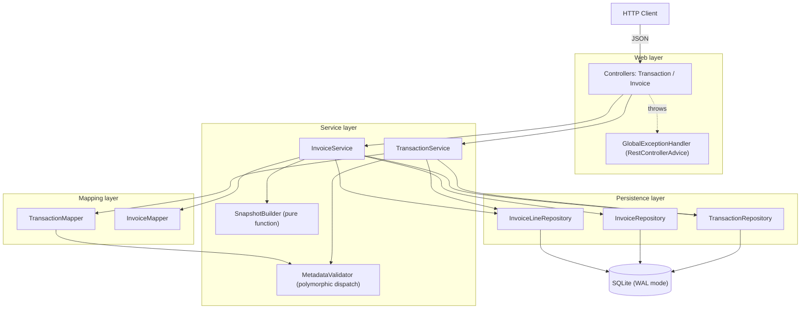
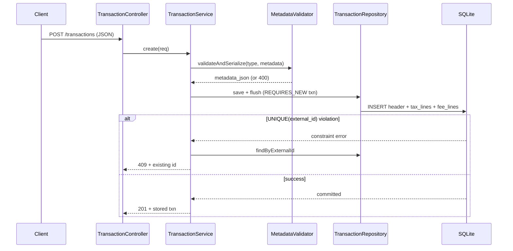
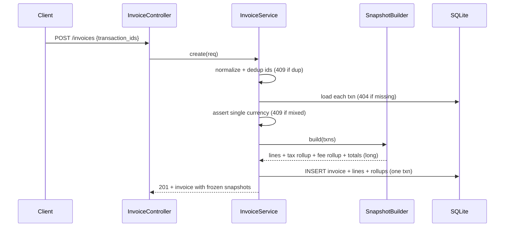
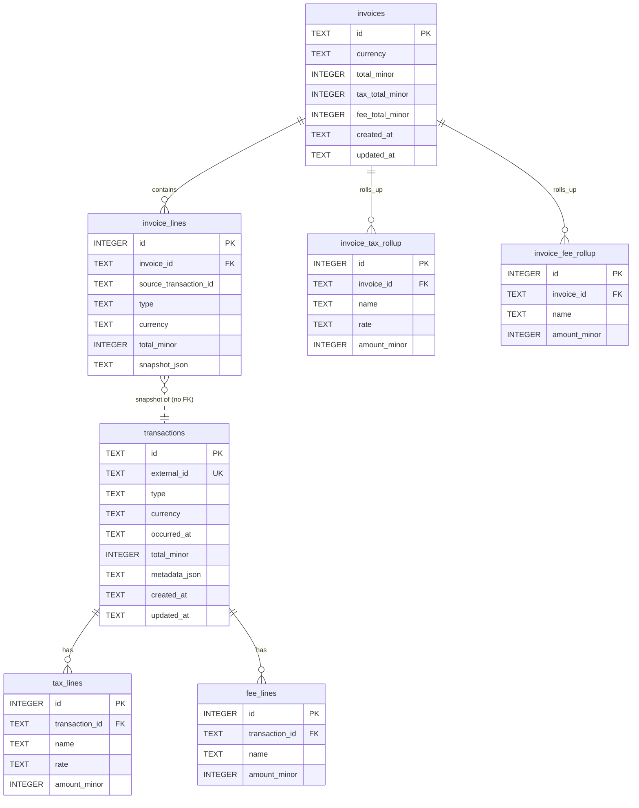

# Architecture — Navan Travel Transactions & Invoice Service

This document is the single architecture reference for the service: the high-level
design (HLD), the low-level design (LLD), the full data model with every table and
index, and the behaviour under volume — covering `external_id` uniqueness, concurrent
POSTs, the invoice snapshot, the tables and models, and high volume as the brief asks.

---

## 1. High-Level Design (HLD)

### 1.1 What the service does

A small HTTP API that ingests **already-structured** travel commerce transactions
(flight, hotel, rail, navan_fee) on a single create endpoint, and builds
**invoices** from them. The defining rule: an invoice is a **frozen snapshot** —
once a transaction is billed, later edits to that transaction must never change an
already-issued invoice.

Three properties drive the whole design:

1. **Identity** — the same `external_id` must never create two rows, even under
   two overlapping concurrent POSTs.
2. **Immutability of billed money** — an invoice is a copy, not a live join.
3. **Correct money** — no IEEE float ever touches a total.

### 1.2 Component view



### 1.3 Layering and responsibilities

| Layer | Package | Responsibility | Must NOT |
|---|---|---|---|
| Web | `controller`, `exception` | HTTP binding, status codes, validation entry, error translation | Contain business rules |
| Service | `service`, `metadata` | Business rules, transactions, freeze checks, snapshot math | Know about HTTP |
| Mapping | `mapper` | Entity ↔ DTO, `long`↔`BigDecimal`, JSON (de)serialization | Hold state |
| Persistence | `repository`, `entity` | CRUD, queries, indexes | Contain money logic |
| Cross-cutting | `config`, `util` | DataSource/Jackson config, money & id helpers | — |

The brief explicitly warns against "one god-class that owns routing and storage."
The seams above are the direct answer: HTTP handlers, transaction persistence,
duplicate identity, and invoice snapshot/rollup are each isolated and independently
testable.

### 1.4 Technology stack

| Concern | Choice | Why |
|---|---|---|
| Language / framework | Java 17, Spring Boot 3.2.5 | Matches Navan production stack |
| Persistence | Spring Data JPA (Hibernate) | Standard repository abstraction |
| Database | SQLite (file `data/navan.db`) | Real DB, zero setup for the grader |
| Dialect | `hibernate-community-dialects` SQLiteDialect | JPA ↔ SQLite |
| Pool | HikariCP | Connection pooling |
| JSON | Jackson | Metadata & snapshot (de)serialization |
| Health/metrics | Spring Boot Actuator | `/actuator/health` |

SQLite is the right call for a self-contained take-home. The SQLite-specific
accommodations (see §4.2 and §4.3) would be dropped on Postgres in production.

### 1.5 Primary request flows

**Create transaction (`POST /transactions`)**



**Create invoice (`POST /invoices`)**



---

## 2. Low-Level Design (LLD)

### 2.1 Package map

```
com.example.navan
├── NavanApplication            # Spring Boot entry point
├── config
│   ├── SQLiteDataSourceConfig  # WAL + busy_timeout + FK pragmas on every connection
│   └── JacksonConfig           # exact-BigDecimal node factory (the one un-YAML-able setting)
├── controller
│   ├── TransactionController    # /transactions  CRUD + list
│   └── InvoiceController        # /invoices       CRUD + list
├── service
│   ├── TransactionService       # create/get/list/patch/delete + duplicate 409
│   ├── InvoiceService           # create/get/list/patch/delete + currency/dup checks
│   ├── SnapshotBuilder          # PURE: txns -> SnapshotResult (freeze + rollup + totals)
│   └── SnapshotData             # record: shape persisted into invoice_lines.snapshot_json
├── metadata
│   ├── MetadataValidator        # polymorphic: type -> POJO -> validate -> JSON
│   ├── FlightMetadata / HotelMetadata / RailMetadata / NavanFeeMetadata
├── mapper
│   ├── TransactionMapper        # entity <-> request/response; long<->BigDecimal
│   └── InvoiceMapper            # entity + snapshot_json -> response
├── dto                          # wire contracts (records, immutable)
├── entity                       # JPA entities (7)
├── repository                   # Spring Data repositories (3)
├── enums                        # TransactionType, FeeKind (lowercase JSON)
├── exception
│   ├── ApiException             # carries HttpStatus + nullable existingId
│   └── GlobalExceptionHandler   # maps exceptions -> ErrorResponse
└── util
    ├── Money                    # BigDecimal <-> long minor units, HALF_UP
    └── IdGenerator              # txn_<uuid> / inv_<uuid>
```

### 2.2 Money handling (highest-risk path)

Single rule, enforced in exactly one place (`util/Money`):

```java
// edge (BigDecimal, scale 2) -> core (long cents)
toLong(BigDecimal a)  = a.setScale(2, HALF_UP).movePointRight(2).longValueExact();
// core (long cents)   -> edge (BigDecimal, scale 2)
fromLong(long minor)  = BigDecimal.valueOf(minor, 2);
```

- **At the edge** (DTOs) money is `BigDecimal`, scale 2.
- **In the core** (entities, arithmetic, DB) money is `long` minor units (cents).
- **Rounding** is `HALF_UP`, applied once, at the boundary.
- **No IEEE float** ever participates; Jackson parses JSON numbers as `BigDecimal`
  (`USE_BIG_DECIMAL_FOR_FLOATS`) and serializes plain (`WRITE_BIGDECIMAL_AS_PLAIN`),
  and the JsonNode factory keeps exact scale (`withExactBigDecimals(true)`) so
  `250.00` never degrades to `2.5E+2`.

All invoice summation happens on `long` in `SnapshotBuilder` — no `BigDecimal`
accumulation, so no drift.

### 2.3 Metadata subsystem — polymorphic dispatch

Type-specific fields (flight coupons, hotel address, rail legs, fee kind) differ per
type and are **read whole, never queried by sub-field**, so they live in a single
`metadata_json` column — but validated and typed at the application edge:

```
MetadataValidator.validateAndSerialize(type, rawJson):
   switch(type):
     flight    -> deserialize to FlightMetadata   -> validate -> serialize
     hotel     -> deserialize to HotelMetadata     -> validate -> serialize
     rail      -> deserialize to RailMetadata       -> validate -> serialize
     navan_fee -> deserialize to NavanFeeMetadata   -> validate fee_kind -> serialize
     else      -> ApiException(400)                 # unknown type
```

`deserializeMetadata(type, json)` is the inverse, used by the mappers to produce
typed metadata on GET. This is the single place the type→schema mapping lives, which
is why the metadata POJOs and the validator share a package (cohesion). Unknown
`type` or unknown `navan_fee.fee_kind` → **400**; no dummy metadata is ever stored.

### 2.4 Duplicate identity & concurrent create

The authoritative guard is the DB: `UNIQUE INDEX ux_transactions_external_id`.
The service uses **insert-and-catch** (not check-then-insert, which races):

```
create(req):
  metadata_json = validate(...)
  try:                                  # REQUIRES_NEW transaction, isolated
      save + flush
      return 201
  catch RuntimeException:               # see §4.3 for why not a typed catch
      existing = findByExternalId(req.external_id)
      if existing != null: return 409 + existing.id
      else: rethrow -> 500
```

- Runs in its own `TransactionTemplate` with `PROPAGATION_REQUIRES_NEW`, so a
  constraint failure rolls back cleanly and the follow-up read runs in a fresh
  session.
- Two overlapping POSTs: one wins the unique index, the other fails, catches, reads
  the winner's row, and returns 409 with that id. Net effect: **exactly one row**
  (proven by `ConcurrencyTest` with 10 threads).

### 2.5 Invoice snapshot — the freeze

`invoice_lines` is **one frozen copy per transaction**, not a foreign-key join:

```
InvoiceService.create(req):
  ids   = req.normalizedIds()           # single id or list
  dedup -> 409 if an id repeats
  txns  = load each id                  # 404 if any missing
  assert single currency                # 409 if mixed
  result = SnapshotBuilder.build(txns)
  persist invoice header + invoice_lines(snapshot_json) + rollups   # one atomic txn
```

Each `invoice_lines.snapshot_json` stores a copy of the transaction's metadata, tax
lines, and fee lines at invoice time. Because it is a copy, mutating the source
transaction afterwards cannot change the invoice — verified by test
(edit flight total to a new value → invoice line still reads `220.00`).

### 2.6 SnapshotBuilder — pure function

Pulled out of `InvoiceService` precisely because it is pure (data in → data out, no
I/O, no transactions), which makes the money math testable in isolation:

```
build(List<TransactionEntity>) -> SnapshotResult:
  for each txn:
     line.snapshot_json = { metadata_json, tax_lines[], fee_lines[] }
  tax_rollup = group tax lines by (name, rate)  -> sum amount_minor
  fee_rollup = group fee lines by (name)         -> sum amount_minor
  total_minor     = Σ txn.total_minor
  tax_total_minor = Σ all tax line amount_minor
  fee_total_minor = Σ all fee line amount_minor
```

All arithmetic is on `long`. Rollup grouping keys: tax by `name||rate`, fee by `name`
(documented choice).

### 2.7 Freeze rules (PATCH / DELETE)

Both `TransactionService.patch` and `.delete` first call
`invoiceLineRepository.existsBySourceTransactionId(id)`:

- on an invoiced transaction → **409**, persist nothing (snapshot stays frozen);
- otherwise proceed. PATCH replaces tax/fee lines wholesale via JPA `orphanRemoval`;
  DELETE cascades to tax/fee lines.

`existsBySourceTransactionId` is backed by `ix_invoice_lines_txn` so the check is an
index probe, not a scan.

### 2.8 Pagination

Both list endpoints require `limit` (default 50, **max 100** → `400` above that) and
`offset`, executed as `LIMIT :limit OFFSET :offset` native SQL ordered by
`(created_at DESC, id DESC)`. Nothing is loaded into memory to "paginate in app."
`PageResponse` returns `items`, `limit`, `offset`, `total`, and `nextOffset`.

> Current implementation is **offset** pagination. The `(created_at, id)` index is
> deliberately in place so this can switch to **keyset**
> (`WHERE (created_at, id) < (?, ?)`) without a schema change when deep offsets
> become a cost.

### 2.9 Error handling

`ApiException(HttpStatus status, String message, String existingId?)` is the one
typed exception; it carries both the status to return and the nullable duplicate id.
`GlobalExceptionHandler` (`@RestControllerAdvice`) maps:

| Exception | HTTP | Body |
|---|---|---|
| `ApiException` | its `status` | `{error, status, existing_id?}` |
| `MethodArgumentNotValidException` | 400 | first field error |
| `HttpMessageNotReadableException` | 400 | malformed JSON |
| `NoResourceFoundException` | 404 | unknown route |
| `Exception` (fallback) | 500 | generic |

---

## 3. Data model

### 3.1 Entity–relationship diagram



Note the dotted edge: `invoice_lines.source_transaction_id` references a transaction
by **value, not a foreign key** — deliberately, so deleting or editing a transaction
cannot mutate or cascade into a frozen invoice.

### 3.2 Normalization strategy — hybrid, by design

| Data | Storage | Normal form | Rationale |
|---|---|---|---|
| Transaction header | `transactions` columns | 3NF | Queried, indexed, unique |
| Taxes / fees | `tax_lines`, `fee_lines` tables | 3NF | Money rows — summed and rolled up; must be columns |
| Type-specific metadata | `metadata_json` column | denormalized (document) | Read whole, never filtered by sub-field; shape varies per type |
| Invoice rollups | `invoice_tax_rollup`, `invoice_fee_rollup` | 3NF | Money rows on the invoice |
| Invoice line snapshot | `snapshot_json` column | denormalized (document) | **Intentional copy** to freeze billed state |

So money is fully relational (3NF) where it must be queried/aggregated, and
type-specific payloads are documents where relational modelling would add four
polymorphic schemas for zero query benefit. The one place we denormalize money
(`snapshot_json`) is the whole point of the exercise: immutability of billed totals.

### 3.3 Table reference

**`transactions`** — one row per transaction; `external_id` is the client identity.
Money as `total_minor` (cents). `metadata_json` holds the typed payload.

**`tax_lines` / `fee_lines`** — child rows (1-to-many), `ON DELETE CASCADE` from the
transaction. `rate` is nullable text on taxes (e.g. `0.07`); fees have no rate.

**`invoices`** — header with `currency` and three money totals (`total_minor`,
`tax_total_minor`, `fee_total_minor`).

**`invoice_lines`** — one frozen snapshot per included transaction.
`source_transaction_id` is a value reference (no FK). `snapshot_json` is the frozen
copy.

**`invoice_tax_rollup` / `invoice_fee_rollup`** — invoice-level aggregates grouped by
name (and rate for taxes), each `ON DELETE CASCADE` from the invoice.

> Timestamps are stored as ISO-8601 UTC **TEXT**. Lexicographic ordering equals
> chronological ordering for that format, which is what the `(created_at, id)`
> indexes rely on.

### 3.4 Indexes

| Index | Table (cols) | Purpose | Requirement it serves |
|---|---|---|---|
| `ux_transactions_external_id` | `transactions(external_id)` **UNIQUE** | Enforce identity; power duplicate 409 | "unique index on external_id" |
| `ix_transactions_created` | `transactions(created_at, id)` | Cheap ordered pagination / keyset-ready | "lists cheap under volume" |
| `ix_tax_lines_txn` | `tax_lines(transaction_id)` | Load a txn's taxes without scan | fast `GET /transactions/{id}` |
| `ix_fee_lines_txn` | `fee_lines(transaction_id)` | Load a txn's fees without scan | fast `GET /transactions/{id}` |
| `ix_invoices_created` | `invoices(created_at, id)` | Ordered invoice pagination | "lists cheap under volume" |
| `ix_invoice_lines_txn` | `invoice_lines(source_transaction_id)` | "is this txn on an invoice?" probe | freeze-rule 409 check |
| `ix_invoice_lines_inv` | `invoice_lines(invoice_id)` | Load an invoice's lines | fast `GET /invoices/{id}` |
| `ix_tax_rollup_inv` | `invoice_tax_rollup(invoice_id)` | Load tax rollup | fast `GET /invoices/{id}` |
| `ix_fee_rollup_inv` | `invoice_fee_rollup(invoice_id)` | Load fee rollup | fast `GET /invoices/{id}` |

---

## 4. Concurrency & correctness

### 4.1 Atomic writes

Transaction create and invoice create/patch each write the header and all children
in **one** transaction (all persist or none). Transaction create additionally uses
`PROPAGATION_REQUIRES_NEW` so the constraint-failure path rolls back in isolation.

### 4.2 SQLite connection configuration (`SQLiteDataSourceConfig`)

SQLite defaults are wrong for a concurrent web service, so every pooled connection is
configured via `SQLiteConfig`:

| Pragma | Value | Why |
|---|---|---|
| `journal_mode` | **WAL** | Readers don't block writers; required for the concurrency test |
| `busy_timeout` | **5000 ms** | A contending writer waits instead of failing instantly with `SQLITE_BUSY` |
| `foreign_keys` | **ON** | SQLite disables FKs by default; needed for `ON DELETE CASCADE` |

This is done in Java (not `connection-init-sql`) because Hikari did not reliably run
multiple semicolon-separated PRAGMAs; the `SQLiteConfig` API applies them
deterministically to each connection.

### 4.3 Why the duplicate catch is broad

Hibernate's **community** SQLite dialect maps a `SQLITE_CONSTRAINT_UNIQUE` to a
generic `JpaSystemException`/`GenericJDBCException`, **not**
`DataIntegrityViolationException`. So the catch cannot match on exception type;
instead it catches `RuntimeException` and **resolves by existence**: if a row with
that `external_id` now exists, it is definitively a duplicate → 409; otherwise the
exception is rethrown (→ 500). This also cleanly covers the post-`busy_timeout`
concurrency loser. On Postgres this would be a precise typed catch or an
`INSERT ... ON CONFLICT`.

---

## 5. High volume — what breaks first, and the mitigation

Under heavy concurrent PATCH + duplicate POST + large lists, in order of what bites
first:

1. **Unbounded list reads** — the classic `SELECT *` table dump.
   *Mitigation:* mandatory `limit` (default 50, max 100) + `offset`, `LIMIT`-bounded
   SQL, ordered by an indexed `(created_at, id)`. Nothing is paginated in memory.

2. **"Is this transaction invoiced?" on every PATCH/DELETE** — a scan would dominate
   under write load. *Mitigation:* `ix_invoice_lines_txn` turns it into an index
   probe.

3. **Duplicate-POST storms** — concurrent inserts of the same `external_id`.
   *Mitigation:* the DB `UNIQUE` index is the single arbiter; losers are caught and
   converted to 409. No app-level lock, no Redis.

4. **Single-writer contention (SQLite-specific)** — SQLite serializes writers.
   *Mitigation here:* WAL + `busy_timeout`. *Mitigation in production:* this is the
   first reason to move to Postgres, which gives real MVCC and row-level locking.
